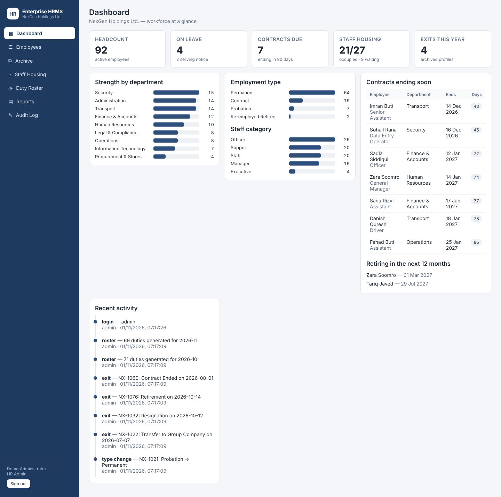
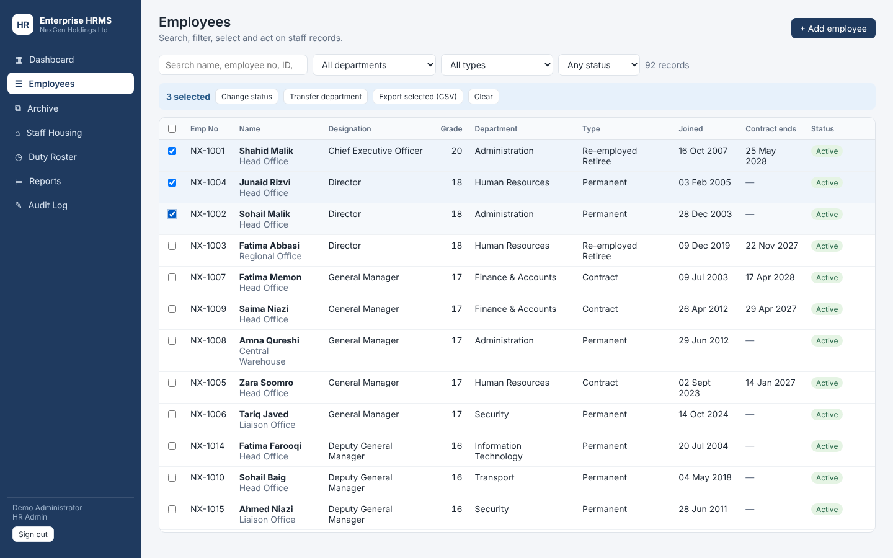
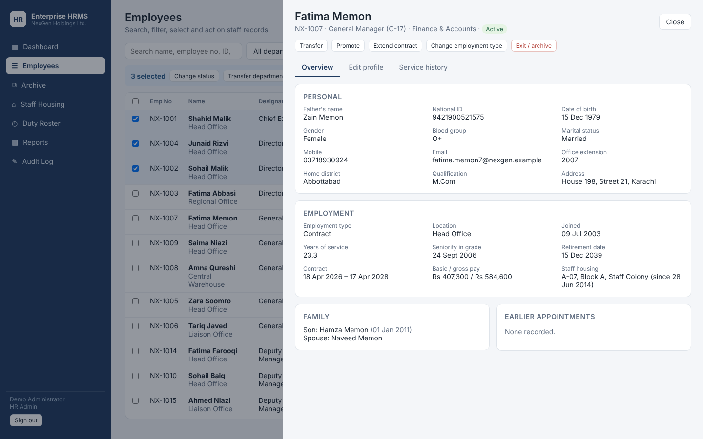
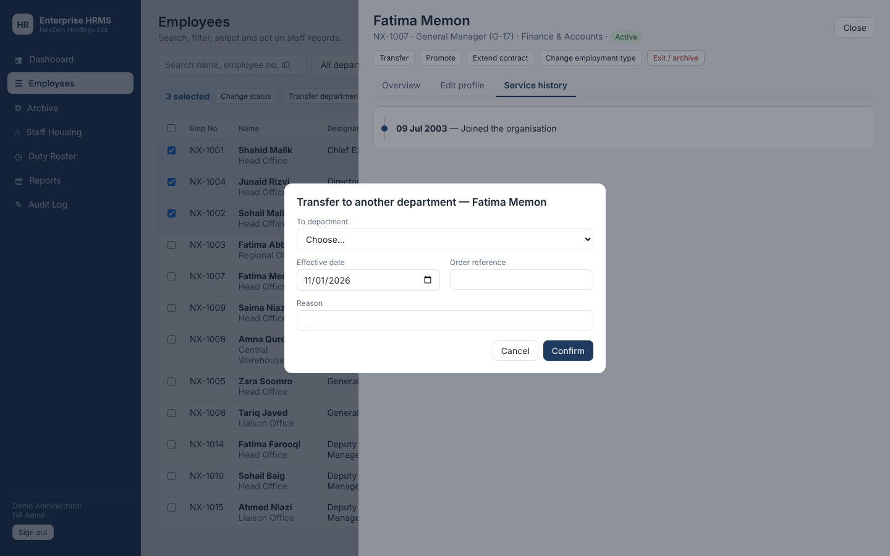
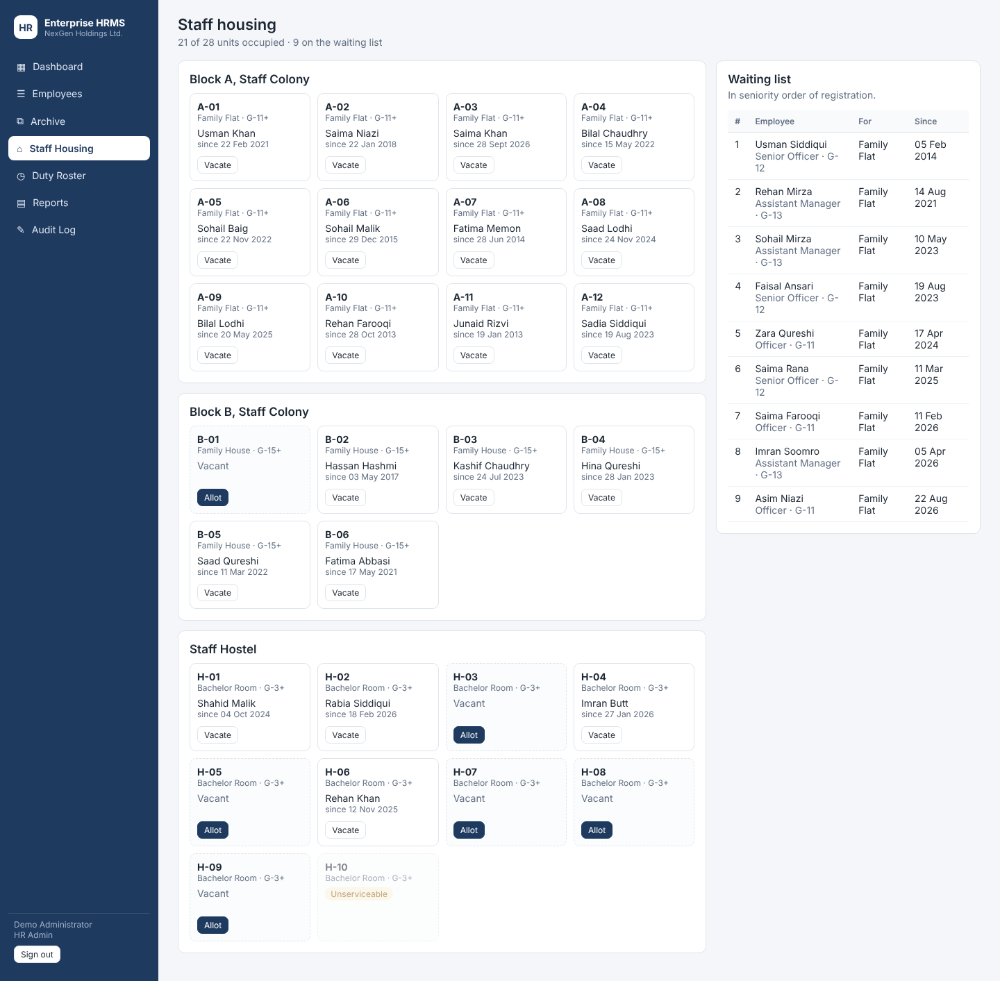
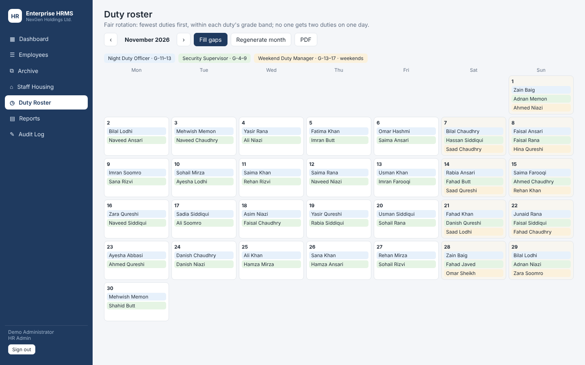
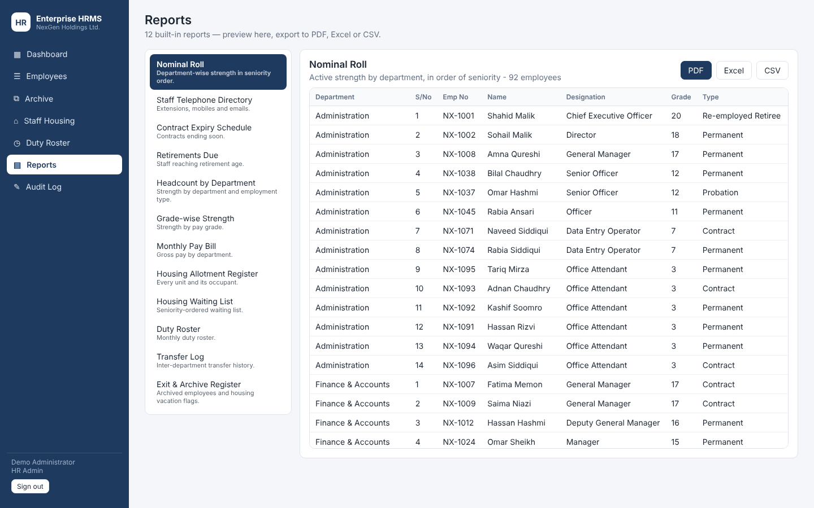
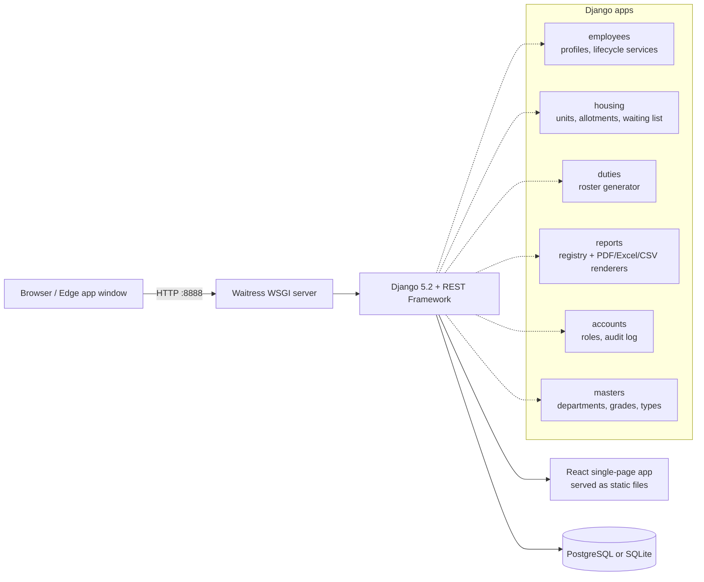

# Enterprise HRMS: Human Resource Management System

[](https://www.python.org/)
[](https://www.djangoproject.com/)
[](https://react.dev/)
[](https://www.postgresql.org/)
[](https://docs.pylonsproject.org/projects/waitress/)
[](#testing)

> **Turns spreadsheet-based staff records into a proper HR system, covering the full employee lifecycle, staff housing, duty rosters and ready-made reports.**
> Runs offline on a single Windows PC or a LAN, including older office hardware, with one-click launchers for non-technical staff.

All data in this repository is **synthetic demo data** for a fictional company, *NexGen Holdings Ltd.* Every name, ID number and phone number is randomly generated.



---

## What it does

Many HR offices still keep their staff records in one large Excel workbook. Each transfer, promotion or contract extension means editing several sheets, and the history gets lost along the way. Enterprise HRMS keeps **one profile per employee** and records every change against it, so the current position and the full service history are always one click away.

### Key highlights
- **Complete employee lifecycle**: transfers, promotions, contract extensions with optional pay revision, employment-type conversion (e.g. Probation → Permanent, Contract → Permanent) and exit/archival. Each change is recorded with an order reference, and none of them creates a duplicate profile.
- **Bulk operations**: select any number of staff to change status, transfer them between departments, or export them to CSV in one action.
- **Staff housing**: unit inventory with grade entitlement, allotment and vacation, and a seniority-ordered waiting list. When someone exits, their unit is vacated automatically and a housing-vacation notice is flagged.
- **Fair duty roster**: monthly rosters generated automatically within each duty's grade band. The staff with the fewest duties are picked first, nobody gets two duties on the same day, and weekend-only duties are supported.
- **12 built-in reports**: preview on screen, then export to **PDF**, **Excel** or **CSV**.
- **Data validation**: 13-digit national ID (dashes stripped automatically), mobile-number format, and contract-date rules.
- **Audit trail**: every lifecycle, bulk, housing and roster action is logged with the user and the time.
- **Role-based access**: HR Admin, HR Officer and read-only Viewer.

---

## Screenshots

| Employee directory with bulk actions | Employee profile |
| :---: | :---: |
|  |  |
| **Lifecycle action (transfer)** | **Staff housing and waiting list** |
|  |  |
| **Automatic duty roster** | **Reports (PDF / Excel / CSV)** |
|  |  |

---

## System architecture



Business rules live in small service modules (`employees/services.py`, `housing/services.py`, `duties/services.py`). Each one runs inside a database transaction and writes an audit entry. The API and the tests both call these same functions.

---

## Features

### Employee records
- Personal, contact and employment details, pay (basic and allowances), family members, and a dynamic table of earlier appointments.
- Calculated fields: retirement date (age 60), years of service, gross pay.
- Search by name, employee number, national ID, mobile or designation. Filter by department, employment type and status.
- Exited employees move to the **Archive**, where their full history is kept. Employees are never deleted.

### Lifecycle workflows
| Action | What is recorded |
| :--- | :--- |
| Transfer | From/to department, effective date, order reference, reason |
| Promotion | From/to designation, new grade seniority date, optional new basic pay (must be a higher grade) |
| Contract extension | Previous and new contract dates, old and new pay when revised (contractual staff only) |
| Employment-type change | From/to type; contract dates set or cleared automatically |
| Exit / archive | Date, category, destination, reliever, handover notes; housing vacated and flagged |

### Reports
Nominal roll · Staff telephone directory · Contract expiry schedule · Retirements due · Headcount by department · Grade-wise strength · Monthly pay bill · Housing allotment register · Housing waiting list · Duty roster · Transfer log · Exit & archive register.

---

## Security and access control

| Role | Can do |
| :--- | :--- |
| **HR Admin** | Everything, including master data (departments, designations, types, duty types) and the Django admin |
| **HR Officer** | Add and edit employees, run lifecycle and bulk actions, allot housing, generate rosters |
| **Viewer** | Read-only access to all screens and reports |

- Secrets and database credentials are read from environment variables (`backend/.env`). There are no passwords in the code.
- Production start-up (`DJANGO_DEBUG=False`) refuses to run without `DJANGO_SECRET_KEY`. PostgreSQL mode refuses to run without `HRMS_DB_PASSWORD`.
- Session authentication with CSRF protection, plus Django ORM protection against SQL injection.

---

## Quick start

### Option A: Windows, one click (SQLite, no database server needed)
1. Install **Python 3.10 or newer** (tick *Add Python to PATH*).
2. Double-click **`scripts\install.bat`**. It creates the virtual environment, installs dependencies, sets up the database and loads the demo data.
3. Double-click **`scripts\start_hrms.bat`**. The app opens at http://127.0.0.1:8888/.
4. Stop it with **`scripts\stop_hrms.bat`**. Take a backup with **`scripts\backup_hrms.bat`**.

### Option B: manual (any OS)
```bash
cd backend
python -m venv venv
source venv/bin/activate          # Windows: venv\Scripts\activate
pip install -r requirements.txt
python manage.py migrate
python manage.py seed_demo
python manage.py runserver 8888
```

### Using PostgreSQL
Copy `backend/.env.example` to `backend/.env`, then set `HRMS_DB_ENGINE=postgres`, `HRMS_DB_PASSWORD` and the other database settings, and run `python manage.py migrate` and `python manage.py seed_demo`.

### Demo credentials

| Username | Password | Role |
| :--- | :--- | :--- |
| `admin` | `admin123` | HR Admin |
| `hrofficer` | `officer123` | HR Officer |
| `viewer` | `viewer123` | Viewer |

These accounts exist only in the seeded demo database. Change them before any real use.

### Frontend development
The built React app is committed in `frontend/dist`, so Node.js is **not** needed to run the system. To change the UI:
```bash
cd frontend
npm install
npm run dev        # http://127.0.0.1:5444, proxies /api to Django on :8888
npm run build      # rebuilds frontend/dist
```

---

## Testing

```bash
cd backend
pytest
```

95 tests cover national-ID and mobile validation, every lifecycle rule (transfers, promotions, extensions with pay revision, type conversion, exit with housing vacation), bulk actions, housing entitlement and double-allotment prevention, waiting-list order, roster fairness and clash-free days, all 12 reports in every format, role permissions and production-settings hardening.

---

## Project layout

```text
HRMS-Enterprise/
├── backend/
│   ├── config/        # Settings (env-driven), URLs, WSGI
│   ├── accounts/      # Login, roles, audit log, backup command
│   ├── masters/       # Departments, designations/grades, employment types, locations
│   ├── employees/     # Employee profile, history models, lifecycle services, seed_demo command
│   ├── housing/       # Units, allotments, waiting list
│   ├── duties/        # Duty types and roster generator
│   ├── reports/       # Report registry and PDF/Excel/CSV renderers
│   └── tests/         # pytest suite
├── frontend/          # React + Vite single-page app (dist/ is prebuilt)
├── scripts/           # Windows install / start / stop / status / backup launchers
└── docs/screenshots/
```

---

## Author

- **GitHub:** [@Rizkayani19](https://github.com/Rizkayani19)
- Python/Django developer building HR, administration and finance systems for offline and LAN environments. See also [EABMS-Demo](https://github.com/Rizkayani19/EABMS-Demo).
